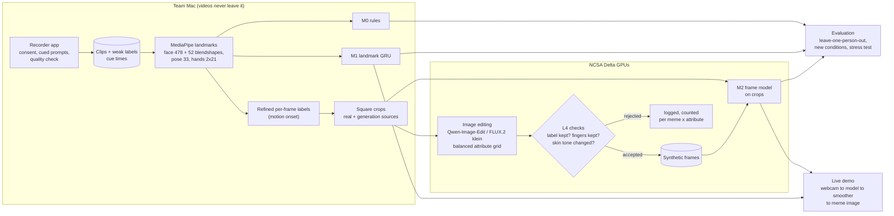

# Ventura Webcam: Meme Pose Recognition with Synthetic Domain Randomization

DATA 4620 final project · Otis Hunt, Carson, Minh, Kevin · Fall 2026

A live webcam system that recognizes which meme a person is imitating and replaces the
camera feed with that meme. The research question is about data: **all of our training
data comes from just the four of us**, so we use open-weight generative image models to
make appearance-randomized versions of our own recordings. The variants change skin tone,
gender presentation, age, hair, clothing, background and lighting. We then test whether
this *generative domain randomization* beats training on real data alone and beats
classic augmentation.

> **Where to go next:** [docs/RUNBOOK.md](docs/RUNBOOK.md) has setup and commands for the
> Mac and NCSA Delta. [docs/HANDOFF.md](docs/HANDOFF.md) has the full design, constraints
> and decision log. [meme-recorder/](meme-recorder/README.md) is the recording app.

---

## The task

The model chooses among 11 memes plus `no_meme`, frame by frame, from a webcam stream.

| id | meme | what matters |
|---|---|---|
| `arms_raised` | Breaking free (both fists high overhead) | arms |
| `point_at_self` | "Who, me?" | hand + face |
| `sleepy_squint` | Lightskin stare dog (half-closed eyes) | face |
| `pinch_grin` | Reddit mod (pinched fingers, sly grin) | hand + face |
| `timeout` | Shaq "T" hands | hands |
| `hands_on_head` | Shocked, hands on head | hands + face |
| `shrek_side_eye` | Side-eye with a raised brow | face |
| `holding_laugh` | Trying not to laugh | face |
| `confused_tilt` | Swaggy P "???" head tilt | head + face |
| `point_sideways` | Pointing Wojak | arm + face |
| `pure_cinema` | "Absolute Cinema" (open hands raised beside the head) | hands + arms |
| `no_meme` | everything else, including 9 deliberately tricky look-alike movements | — |

The hard part is not the clear-cut poses. It's telling apart near-identical expressions
(side-eye vs. head tilt, sleepy vs. trying not to laugh) and *not* firing when someone
stretches, waves or rubs their eyes.

## System overview



### 1. Data collection: the recorder

The recorder is a local web app in `meme-recorder/`, launched with `run_local.command` and
reachable only from the Mac it runs on.
- **Session flow:** consent, then camera setup, then 43 prompts in random order: 11 memes
  × 3, plus 9 tricky negatives and a 60-second free-behavior clip.
- **Cues:** each clip runs neutral → **NOW** → hold → **RELAX**, and the cue times are
  saved as weak labels.
- **Variation:** with only four people, the variety has to come from each person's
  sessions. Each of us records several sessions with different rooms, lighting, cameras,
  outfits, glasses and distances.
- **Held-out sessions:** one session per person is recorded in conditions used nowhere
  else and kept as a test set.
- **Several laptops (Mac or Windows):** teammates can record on their own laptops. Each laptop prefixes its
  participant IDs (e.g. `CA-P001`), and recordings reach the main Mac as a checksummed zip,
  by AirDrop or USB only, never through GitHub or a cloud drive. The import links each
  person's sessions across laptops by their signed name.

### 2. Preprocessing

- **Landmarks:** MediaPipe runs on every frame for the face (with 52 expression
  blendshapes), pose and both hands.
- **Normalized features:** about 280 per frame, made independent of camera distance and
  framing. A mirror flip is a fixed feature permutation, which makes flip augmentation
  free.
- **Refined labels:** the cue times only say roughly when the pose happened, because
  people react late. We find the actual pose onset and offset from landmark motion
  relative to the clip's own neutral start, and ignore frames right at the boundaries.
  The measured reaction delays are a small result of their own.

### 3. Models

| model | input | role |
|---|---|---|
| **M0 rules** | landmarks | Hand-written geometric rules (fist closure, wrist height, eyelid closure, head roll…), thresholds fitted on training data. The floor every model must beat. |
| **M1 landmark model** | 1 s of landmarks | GRU or temporal CNN. Landmarks already strip out appearance, so we **predict synthetic data helps M1 only a little**. Confirming that is a finding. |
| **M2 pixel model** | face + upper-body crops | Pretrained image backbone fine-tuned on crops. **This is where appearance randomization should matter most.** |
| M3 (stretch) | both | Combine M1 and M2. |

Every model feeds the same **hysteresis smoother**, used in both evaluation and the demo.
A meme appears only after it is the confident top prediction for several frames, and
stays until confidence drops. This keeps the demo from flickering, and the smoother's
false triggers are what we measure.

### 4. Synthetic data: generative domain randomization

The core design rule is **never let regeneration change the label.** We edit our own real
frames instead of generating from text, so the geometry that defines each meme carries
over: eye openness, gaze, brow, finger positions, arm height.

1. **Pick source frames:**
   - meme clips: peak-pose frames, plus a neutral moment
   - negative clips: the movement peaks
   - free-behavior clips: evenly spaced frames

   Memes and non-memes get identical treatment, so "looks generated" can never become a
   shortcut for "is a meme."
2. **Plan balanced edits.** Each edit changes one face attribute (skin tone on the Monk
   scale, gender presentation, age or hair) plus background, clothing and lighting. The
   attribute values are balanced within every meme. Attribute wording comes from a vetted
   list of observable descriptions, never race labels.
3. **Write expression-aware prompts.** The prompt states the *measured* expression
   ("eyes half-closed and heavy-lidded, looking at the camera…") and locks the head,
   arms, hands and fingers. This adapts the mitigation from Seo et al. (2026), who found
   instruction-based editors drift skin tone lighter and add stereotyped features, and
   that spelling out observable features reduces it.
4. **Edit** on Delta GPUs with **Qwen-Image-Edit-2511** (Apache 2.0) as the main model and
   **FLUX.2 [klein]** for comparison. Everything runs locally on our allocation; no
   participant frame goes to a hosted API.
5. **Check every edit (L4).** MediaPipe reruns on the result. An edit is rejected if:
   - expression blendshapes or head tilt moved
   - the meme's rule score dropped
   - the hands, finger shape or arm pose changed
   - a skin-tone edit didn't actually move the skin tone, measured objectively as the
     ITA angle from the cheek pixels

   Rejection rates per meme × attribute are reported as results; they show where the
   generator struggles and whom it serves worse.

### 5. Evaluation

With four people, honest evaluation is the hardest part.

- **Leave-one-person-out (main metric):** 4 folds. A fold's training set never includes
  the test person's real frames *or their synthetic variants*.
- **New-conditions test:** each person's held-out session (unseen room, light and outfit).
- **Synthetic stress test:** accuracy per generated attribute group, reported as a stress
  test, **not** as evidence of fairness for real people.
- **Metrics:**
  - macro-F1 and per-class F1, and confusion matrices with attention to the known
    look-alike pairs
  - false triggers per minute on free-behavior clips
  - which look-alike negatives trigger which memes
  - delay from striking a pose to the meme appearing
  - live frames per second

### 6. Experiments

| | real only | + classic augmentation | + synthetic | synthetic only |
|---|---|---|---|---|
| **M1** | ✓ | ✓ | ✓ | (optional) |
| **M2** | ✓ | ✓ | ✓ | ✓ |

Also planned:
- a synthetic-to-real ratio sweep: 0, 0.5×, 1×, 2× and 4×
- feature prompts on vs. off (the mitigation ablation)
- Qwen vs. FLUX.2 [klein] acceptance rates
- an automated prompt sweep that tunes the edit wording against the L4 acceptance rate

**Improvement cycle (course requirement):**
- **v1:** M0, M1 and M2 on real data plus classic augmentation.
- **Failure analysis:** which memes, conditions and look-alike pairs fail.
- **v2:** add the synthetic frames and re-evaluate on identical splits.

### 7. Live demo

Laptop webcam → MediaPipe and crops → model → smoother → when a meme fires, its image
replaces the feed. Every step only looks backward in time, as the live stream requires.
The target is at least 15 frames per second end to end on an M4 MacBook.

## Where things run

| | Mac | NCSA Delta (`bjeg`) |
|---|---|---|
| Recording, raw videos | ✓ (videos never leave it) | — |
| Landmarks, labels, M0/M1, crops | ✓ (free, no queue) | optional |
| Prompt prototyping | ✓ | ✓ |
| Bulk image editing + L4 checks | — | ✓ A40/H200 GPUs |
| M2 training matrix | — | ✓ |
| Live demo | ✓ | — |

## Ethics and privacy

- **Consent:** only the four of us are recorded, under a written consent form.
- **Where data lives:** videos and derived data stay on team-controlled machines: the Mac,
  and a `chmod 700` folder on Delta. They are git-ignored, never sent to hosted AI
  services, and kept out of iCloud.
- **Stereotyping risk:** changing someone's apparent skin tone or gender with a generative
  model can produce stereotyped results. We use descriptive (not racial) prompts, measure
  skin tone objectively, hand-audit samples, and report rejection rates per attribute.
- **Claims:** four people cannot establish demographic fairness. The claim is limited to
  *robustness to appearance variation under controlled tests*.
- **Meme images** are used only as on-screen prompts, kept in the repository so every
  recording laptop shows the same ones (the repository should be private), and credited in
  `meme-recorder/config/meme_images/SOURCES.md`.

## Status

| | |
|---|---|
| ✅ | Recorder app, local-only launcher, protocol 2026.4 (11 memes) |
| ✅ | Landmark extraction, refined labels, M0 rules, M1 GRU/TCN, LOPO/new-conditions evaluation, metrics |
| ✅ | Synthetic pipeline: frame selection, crops, attribute plan, Qwen/klein backends, L4 checks, acceptance reports |
| ✅ | Mac and Delta configs, Slurm jobs; 16 tests passing on stand-in data |
| ⬜ | Record all four people (several sessions each + one held-out session) |
| ⬜ | Causal ("streaming") feature mode and the live demo |
| 🟨 | M2 frame model (built: DINOv2 ViT-S / EfficientNet-B0; first Delta runs pending) |
| ⬜ | 20-frame prompt prototype → prompt sweep → bulk generation on Delta |
| ⬜ | Training matrix, ablations, report and presentation (mid-December) |

## Repository layout

```
meme-recorder/        recording app (FastAPI + browser UI); data/ is git-ignored
memepose/             pipeline package: extract, labels, features, models/, evaluate, generate/
configs/              pipeline.yaml (classes, settings), mac.yaml, delta.yaml, generation.yaml
scripts/              setup_mac.sh, run_mac.sh, model download
slurm/                Delta jobs: setup, model download, generation array, baselines
tests/                unit + end-to-end tests on stand-in data
docs/                 RUNBOOK.md (how to run), HANDOFF.md (design + decisions)
```

## References

- Seo et al., *Evaluating Demographic Misrepresentation in Image-to-Image Portrait
  Editing*, arXiv:2602.16149 (2026).
- MediaPipe Face, Pose and Hand Landmarkers (Google).
- Qwen-Image-Edit-2511 (Alibaba Qwen, Apache 2.0); FLUX.2 [klein] (Black Forest Labs).
- Monk Skin Tone Scale (Google Research); Individual Typology Angle (ITA) for colorimetric
  skin tone.
